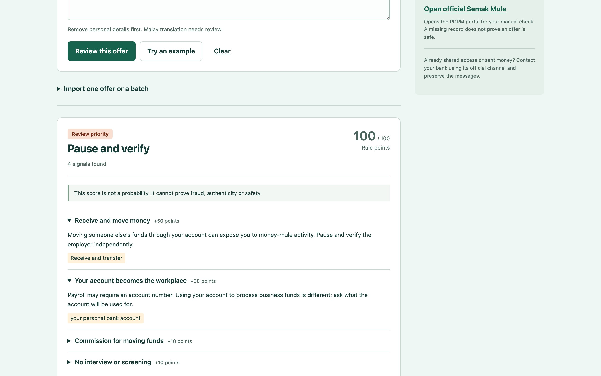
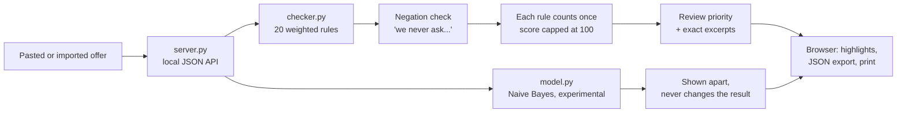
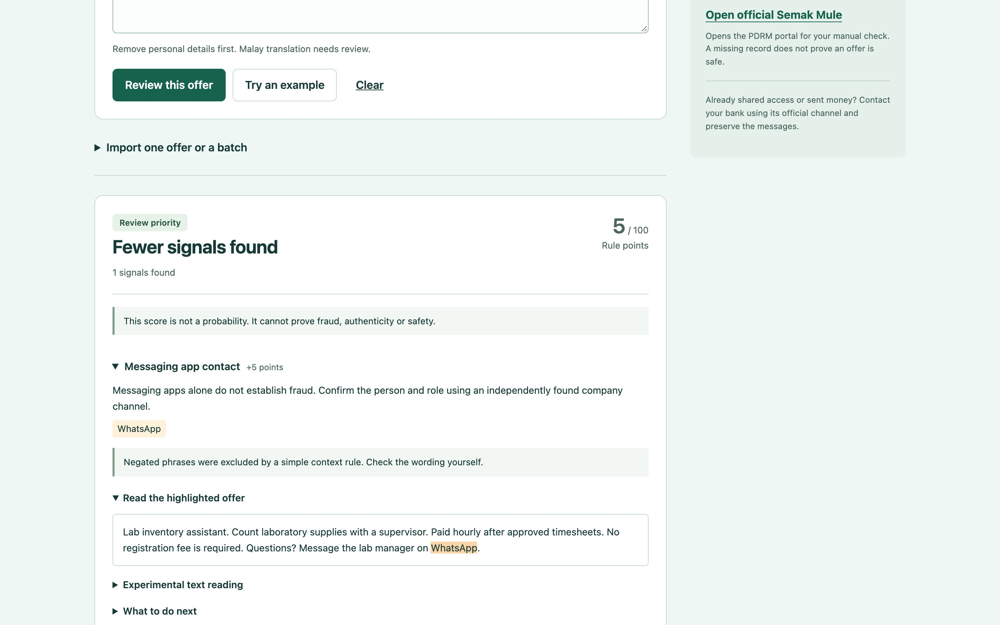
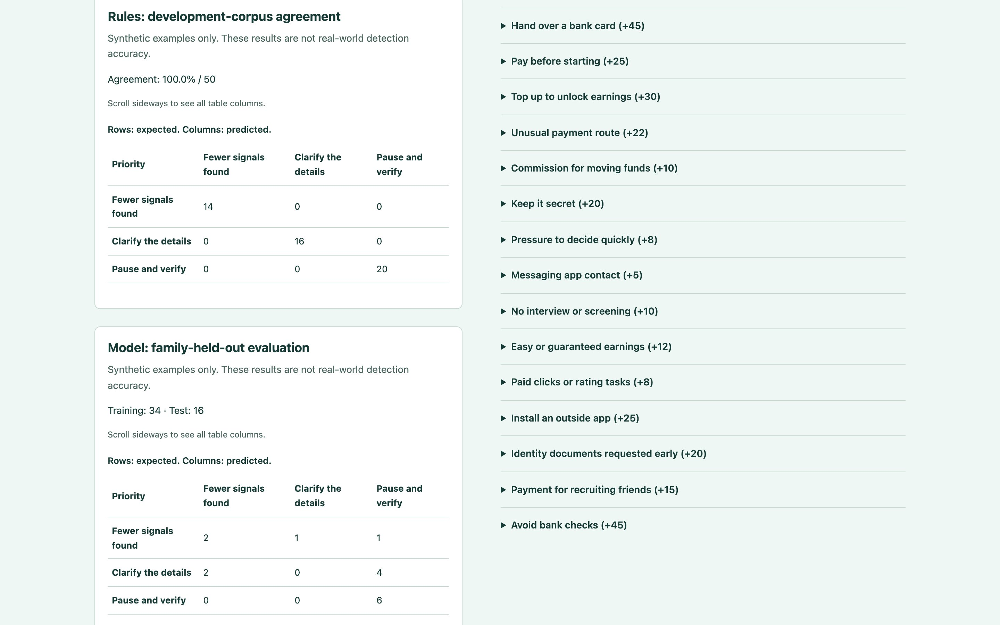
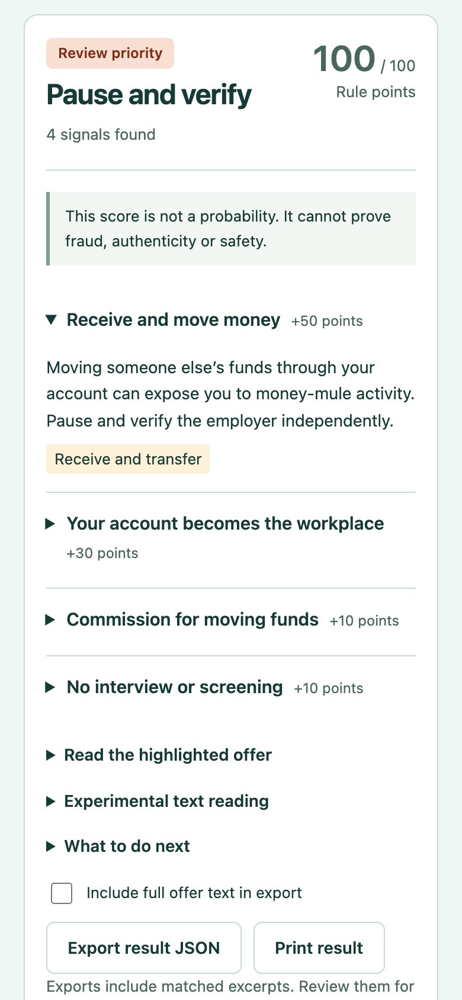

# Pause

A student pastes a part-time job offer, and Pause points to the exact words that deserve a second look before they share money, documents or bank access. It never says "fraud". It says "look closer, here is why".



 

A **money mule** is someone who moves stolen money through their own bank account, often recruited through "easy" part-time jobs. Pause is an educational checker for that situation.

## What it does

- Checks an offer against 20 weighted rules and shows the exact excerpt behind every match.
- Weighs strong requests (receive and forward money, share an OTP code, rent out your account) far above weak context (a WhatsApp contact).
- Gives a review priority, not a verdict: **fewer signals found**, **clarify the details** or **pause and verify**.
- Shows a separate, experimental text model next to the rules, together with its weak test results.
- Imports TXT, CSV or JSON offers, then exports results as JSON or a printed report. Nothing is stored on the server.

## How it works



`checker.py` runs 20 regular-expression rules written for English and draft Malay wording. Each match keeps its start and end offsets, so the browser can highlight the exact words. A short clause check skips matches preceded by "never", "do not" or "jangan" in the same clause, and resets after "but", so "we never ask for passwords, but share your OTP" is still flagged. Each rule adds its weight once. The total (capped at 100) maps to three bands: 0–17, 18–44 and 45–100. `model.py` is a small multinomial Naive Bayes classifier (a word-count model) that gives a second reading, which the interface keeps apart from the rules result.

## Design decisions

**It never says "fraud" or "safe".** The tool cannot know who is behind an offer. The labels describe what to do next, and every result says the score is not a probability. Finding nothing is reported as "this does not confirm the offer is safe".

**Strong signals outweigh weak ones.** Receiving and forwarding money, sharing an OTP and renting an account each carry 50 points, enough on their own to reach "pause and verify". A WhatsApp contact carries 5, because many real employers use it. The weights are editorial choices, written down in the rulebook, not calibrated probabilities.

**Each rule counts once.** A scam message that repeats "easy money" ten times should not score ten times higher. Counting a rule once keeps the score a measure of how many different kinds of risky requests appear.

**The weak model stays visible.** The Naive Bayes model gets 8 of 16 held-out synthetic offers right and 0 of 6 in the ambiguous middle class. Hiding it or tuning it on the test set would make the project look better and be less honest. It is shown beside the rules, labelled experimental, and cannot change the priority.

**Local and minimal by design.** The server binds to `127.0.0.1`, accepts only JSON with a matching Host and Origin, and sends a strict Content-Security-Policy. It does not log offer text, keep history, or fetch links from the offer. The official PDRM Semak Mule portal (a Malaysian police lookup for accounts linked to fraud) is a manual link the student chooses to open.

## Screenshots

**A normal supervised campus role.** One weak signal (WhatsApp, +5) gives "fewer signals found". "No registration fee is required" was recognised as a negated phrase and skipped.



**Rules and model evaluation, side by side with the rulebook.** The rules agree with all 50 development labels because those labels shaped them. The model's held-out results are shown as they are.



<table>
<tr>
<td width="34%"></td>
<td><b>Phone view.</b> The strongest reason opens first. The others stay folded until tapped, and printing opens them all. Export result JSON leaves out the full offer text unless the student ticks the box.</td>
</tr>
</table>

## Run it

Requires Python 3.11 or later. The app uses only the standard library.

```sh
git clone <this repo> && cd mule-job-checker
python3 -m venv .venv
source .venv/bin/activate
pip install -r requirements.txt   # no packages; kept for a standard setup
python server.py                  # http://127.0.0.1:18765/
```

Use `python server.py --port 8312` if the port is busy. The example library and **Try an example** load the fictional corpus in `data/offers.json`; no seeding step is needed.

Command line:

```sh
python checker.py data/example.txt   # analyse one offer
python checker.py --evaluate         # rules vs the 50 development labels
python model.py                      # retrain the model and rewrite its evaluation
python tools/build_corpus.py         # regenerate the fictional corpus
```

## Tests

```sh
python -m unittest discover -s tests -v
```

Result on 20 October 2026 (Python 3.14.6): **26 tests passed**, covering rules, negation and contrast, Unicode offsets, imports, the live HTTP boundary (Host, Origin, media type, static allowlist, no offer text in logs), the train/test split and the Telegram request contracts.

Optional browser checks use Playwright (`npm ci && npx playwright install chromium`, start the app, then `APP_URL=http://127.0.0.1:18765/ npm run test:browser`). The same day: **38 browser checks passed** and the responsive run covered **50 screens** from 320 to 1920 px with no overflow.

## Scope

- All 50 offers are fictional, written for this project. No real offers were collected.
- 100% rule agreement is on the development set that shaped the rules. It is not an accuracy figure.
- The model's 8/16 is on a tiny synthetic hold-out. Neither number says how Pause would do on real messages.
- The Malay rule wording is a draft that needs review by a fluent speaker. The interface is English.
- Rules miss new phrasing and can flag ordinary payroll wording. There is no OCR for screenshots.
- An optional Telegram adapter ([docs/TELEGRAM.md](docs/TELEGRAM.md)) has only been run against fixtures. The campus awareness kit in `campaign/` has not been used with students.
- Next: a consented, independently labelled set of real offers, and an evaluation designed before any tuning.

More detail on the evaluation is in the [case study](docs/CASE-STUDY.md).

## Project layout

```text
server.py             local HTTP server, JSON API, security headers
checker.py            20 weighted rules, negation check, scoring, imports
model.py              Naive Bayes training, held-out evaluation, prediction
telegram_adapter.py   optional bot adapter (fixtures and dry run by default)
verify.py             runs every check and records the results
static/               browser interface (HTML, CSS, JS)
data/                 fictional corpus (JSON, CSV), trained model, fixtures
evidence/             rules and model evaluation results
campaign/             awareness kit and printable poster
tools/build_corpus.py regenerates the corpus
tests/                Python unit and HTTP tests, Playwright browser checks
```

---

Built by Selbinyyaz (Salli) Odekova · [Portfolio](https://selbinyyaz-odekova.web.app) · MIT License
